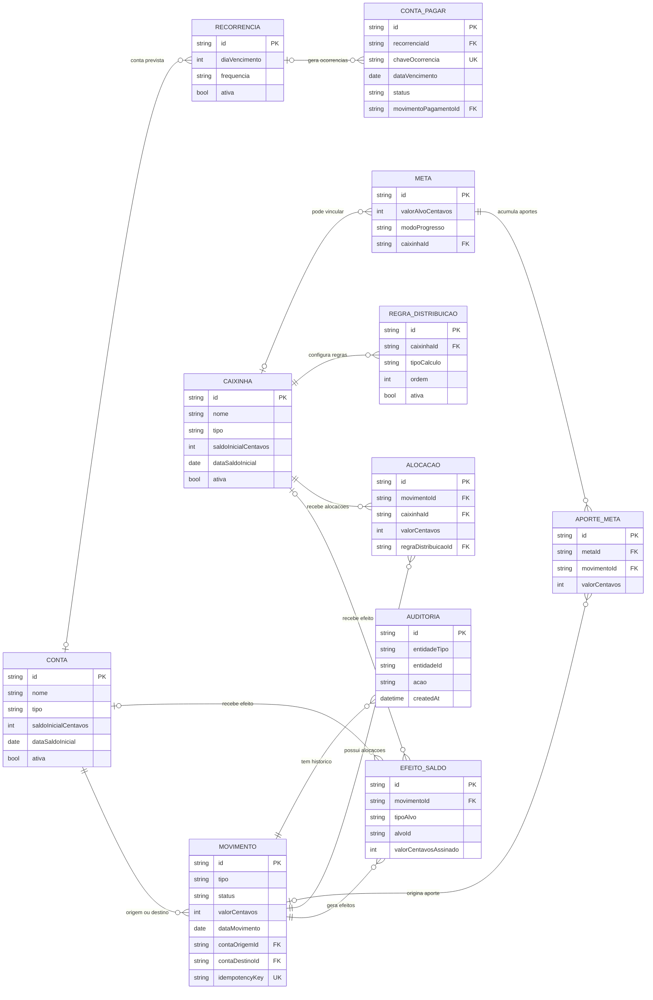

# T5 — Modelo de dados do Tangerina Financeiro

**Projeto:** Tangerina Financeiro  
**Etapa:** M1 — Escopo e decisões do produto  
**Tarefa:** T5 — Definir o modelo de dados (DER)  
**Versão:** 1.0  
**Status:** Modelo de dados aprovado documentalmente; implementação e testes ainda pendentes  
**Base:** T1, T2, T3, T4 e ADR-001 aprovado

> Este documento define uma proposta de estrutura de dados para orientar a implementação. Não significa que o banco ou as funcionalidades já estejam implementados. Regras já aprovadas em T2 são requisitos; pontos marcados como pendentes precisam de decisão antes de serem tratados como comportamento definitivo.

## 1. Objetivos e princípios

O modelo deve suportar o MVP offline-first com Next.js, TypeScript, IndexedDB e Dexie.js, preservando integridade financeira, histórico, exportação e restauração.

1. Persistir valores monetários em **centavos inteiros**.
2. Usar IDs estáveis e independentes da posição dos registros.
3. Diferenciar movimentação financeira, alocação em caixinhas e ocorrência de compromisso.
4. Tratar transferências como operações únicas com dois efeitos correspondentes, sem classificá-las como receita ou despesa.
5. Gravar atomicamente todos os registros que compõem uma operação financeira.
6. Não depender de servidor para as operações centrais.
7. Não apagar o histórico financeiro ao editar ou cancelar uma operação confirmada.
8. Versionar o esquema do banco e implementar migrações compatíveis.

## 2. Diagrama entidade-relacionamento (DER)

O modelo possui uma versão visual editável no FigJam e uma versão Mermaid incorporada a este documento para visualização direta no GitHub.

- **[Abrir o DER visual no Figma / FigJam](https://www.figma.com/online-whiteboard/create-diagram/a2323a68-7d19-4dbc-b716-1a9247cff77e?utm_source=chatgpt&utm_content=edit_in_figjam&oai_id=v1%2FCgc7tEH7jqMMlBu7xr6Gou6KmhwHjoCDclZMzX42Rjye5IukyHpOkw&request_id=fd3464be-fc07-493b-a8a0-cb964002d61e)** — diagrama editável gerado a partir do modelo documentado.
- A representação abaixo é renderizada pelo GitHub em plataformas compatíveis com Mermaid.

**Nota de leitura:** o diagrama resume as entidades e cardinalidades principais; os campos completos, regras de integridade e decisões aprovadas estão descritos nas seções seguintes. Como o banco será IndexedDB/Dexie, os vínculos por ID e as cardinalidades devem ser validados pela aplicação, não por chaves estrangeiras automáticas.

### 2.1. Decisão de modelagem proposta: movimento e efeitos

Recomenda-se manter um registro canônico de **Movimento** e registros explícitos de **EfeitoSaldo** para cada saldo afetado. Por exemplo, uma transferência entre contas possui um único movimento do tipo transferencia_contas e dois efeitos: débito na conta de origem e crédito na conta de destino. Isso evita duplicar a operação no histórico e deixa claro que não é receita nem despesa.

Os saldos devem ser calculados a partir do saldo inicial mais os efeitos confirmados, ou mantidos em projeções derivadas reconstruíveis. Se houver cache de saldo, ele nunca será a única fonte de verdade e deverá ser reconciliável com o livro de movimentos.

## 3. Entidades e campos principais

Os campos abaixo são uma proposta mínima. O campo id será uma string única gerada pela aplicação (por exemplo, UUID). Campos de data devem usar formato ISO ou timestamp normalizado; a zona de exibição será local, sem alterar a data financeira informada pelo usuário.

### 3.1. Conta

Representa uma conta bancária real ou a carteira de dinheiro físico.

| Campo | Tipo | Regra |
|---|---|---|
| id | string | Identificador estável |
| nome | string | Obrigatório |
| tipo | bancaria ou carteira_fisica | Distingue dinheiro bancário de espécie |
| instituicao | string opcional | Nome do banco, se aplicável |
| saldoInicialCentavos | integer | Inteiro em centavos |
| dataSaldoInicial | data | Data-base do saldo inicial |
| ativa | boolean | Arquivamento lógico; não apagar histórico |
| createdAt, updatedAt | timestamp | Auditoria técnica |

Regras:
- A carteira física é representada como conta do tipo carteira_fisica, mas não entra no saldo bancário consolidado.
- O MVP deve evitar criar várias carteiras físicas sem uma decisão explícita sobre essa necessidade.
- Uma conta referenciada por movimentos históricos não deve ser removida fisicamente.

### 3.2. Caixinha

Representa uma destinação virtual global, não vinculada exclusivamente a uma conta bancária.

| Campo | Tipo | Regra |
|---|---|---|
| id | string | Identificador estável |
| nome | string | Obrigatório |
| descricao | string opcional | Texto livre |
| saldoInicialCentavos | integer | Centavos; validação conforme configuração inicial |
| dataSaldoInicial | data | Data-base |
| cor | string opcional | Apresentação, não regra financeira |
| ativa | boolean | Arquivamento lógico |
| createdAt, updatedAt | timestamp | Auditoria técnica |

O saldo atual da caixinha é derivado do saldo inicial e dos efeitos confirmados. A caixinha não é dinheiro adicional nem uma conta bancária.

### 3.3. Movimento

Registro canônico de receita, despesa, transferência, ajuste ou operação relacionada. Campos específicos devem ser opcionais conforme o tipo, com validação discriminada em TypeScript.

| Campo | Tipo | Regra |
|---|---|---|
| id | string | Identificador estável |
| tipo | enum | receita, despesa, transferencia_contas, transferencia_caixinhas, saque_carteira, ajuste_conciliacao |
| status | enum | rascunho, confirmado, cancelado |
| descricao | string | Obrigatória para movimento confirmado |
| valorCentavos | integer positivo | Valor nominal; efeitos indicam os sentidos |
| dataMovimento | data | Data financeira |
| contaOrigemId | string opcional | Obrigatória quando aplicável |
| contaDestinoId | string opcional | Obrigatória para transferência/receita conforme tipo |
| caixinhaId | string opcional | Caixinha primária em despesa/ajuste, quando aplicável |
| idempotencyKey | string | Impede confirmação duplicada da mesma intenção |
| createdAt, updatedAt | timestamp | Datas técnicas |
| confirmedAt | timestamp opcional | Data de confirmação |
| cancelledAt | timestamp opcional | Data do cancelamento |
| motivoCancelamento | string opcional | Justificativa, se solicitada |

Não armazenar números financeiros em ponto flutuante como fonte de verdade. Percentuais podem ser representados em unidades inteiras de precisão documentada (por exemplo, pontos-base) ou decimal validado; a representação escolhida deve ser uniforme e testada.

### 3.4. EfeitoSaldo

Representa o efeito de um movimento em um saldo específico. É uma proposta de implementação para tornar operações compostas explícitas.

| Campo | Tipo | Regra |
|---|---|---|
| id | string | Identificador |
| movimentoId | string | Movimento pai |
| tipoAlvo | enum | conta ou caixinha |
| alvoId | string | ID da conta/carteira ou caixinha |
| valorCentavosAssinado | integer | Crédito positivo; débito negativo |
| estado | enum | Efeito ativo apenas se o movimento estiver confirmado |
| createdAt | timestamp | Data técnica |

Exemplos:
- Receita de R$ 100,00: efeito +10.000 centavos na conta bancária; efeitos positivos nas caixinhas de acordo com as alocações confirmadas. O valor distribuído às caixinhas não cria uma saída bancária separada.
- Despesa de R$ 20,00: efeito −2.000 na conta/carteira de pagamento e, se associada, efeito −2.000 na caixinha.
- Transferência entre contas: −valor na origem e +valor no destino.
- Saque: −valor na conta bancária e +valor na carteira física.
- Transferência entre caixinhas: −valor na caixinha de origem e +valor na de destino, sem efeito em contas.
- Ajustes de conciliação precisam de justificativa e de efeitos explícitos; não reescrevem movimentos antigos.

**Decisão aprovada na revisão da T5:** adotar um movimento canônico com efeitos de saldo explícitos. Os efeitos serão a representação persistida dos impactos financeiros; os saldos exibidos serão derivados deles e dos saldos iniciais, sem uma segunda fonte independente de verdade.

### 3.5. Alocacao

Registra a parcela de uma receita ou despesa atribuída a uma caixinha, bem como o resultado de uma regra de distribuição.

| Campo | Tipo | Regra |
|---|---|---|
| id | string | Identificador |
| movimentoId | string | Movimento relacionado |
| caixinhaId | string | Destino/origem da alocação |
| tipo | enum | credito_receita, debito_despesa, transferencia_entrada, transferencia_saida, ajuste |
| valorCentavos | integer não negativo | Valor alocado |
| regraDistribuicaoId | string opcional | Regra que originou a alocação |
| ordemAplicacao | integer opcional | Ordem da regra |
| baseCalculoCentavos | integer opcional | Base efetivamente usada |
| percentualAplicado | integer/decimal opcional | Percentual aplicado, conforme padrão definido |
| createdAt | timestamp | Data técnica |

A alocação deve guardar os valores calculados e a base utilizada para que a distribuição histórica não mude se uma regra padrão for editada depois. A relação com EfeitoSaldo deve ser definida na implementação para evitar aplicar a mesma alocação duas vezes.

### 3.6. RegraDistribuicao

Define regras padrão de distribuição de receitas.

| Campo | Tipo | Regra |
|---|---|---|
| id | string | Identificador |
| nome | string | Nome da regra |
| caixinhaId | string | Destino |
| tipoCalculo | enum | valor_fixo, percentual_receita_bruta, percentual_saldo_restante |
| valorFixoCentavos | integer opcional | Obrigatório para regra fixa |
| percentual | representação exata | Obrigatório para regra percentual |
| ordem | integer | Define execução |
| ativa | boolean | Ativa/inativa |
| createdAt, updatedAt | timestamp | Datas técnicas |

A ordem deve ser única ou possuir desempate determinístico. A soma calculada nunca pode ultrapassar o valor disponível; o sistema deve mostrar o valor restante. A edição pontual de uma receita não altera a regra padrão.

### 3.7. Recorrencia e ContaPagar

Separar a regra de recorrência das ocorrências individuais evita que uma alteração futura reescreva compromissos já gerados.

**Recorrencia**

| Campo | Tipo | Regra |
|---|---|---|
| id | string | Identificador |
| descricao | string | Obrigatória |
| valorCentavos | integer | Valor previsto |
| diaVencimento | integer 1–31 | Dia pretendido |
| dataInicio | data | Início |
| dataFim | data opcional | Fim, inclusive |
| frequencia | enum | Frequência suportada no MVP |
| ativa | boolean | Interrompe novas ocorrências |
| contaId | string opcional | Conta prevista, não débito automático |
| createdAt, updatedAt | timestamp | Datas técnicas |

**ContaPagar (ocorrência)**

| Campo | Tipo | Regra |
|---|---|---|
| id | string | Identificador |
| recorrenciaId | string opcional | Regra de origem |
| chaveOcorrencia | string | Única por regra e período para impedir duplicidade |
| descricao | string | Cópia histórica da descrição |
| valorCentavos | integer | Cópia histórica do valor previsto |
| dataVencimento | data | Vencimento da ocorrência |
| status | enum | pendente, paga, cancelada |
| movimentoPagamentoId | string opcional | Referência ao movimento se pagamento gerar um |
| createdAt, updatedAt | timestamp | Datas técnicas |

O CA08 de T3 diz que confirmar manualmente o pagamento não deve lançar automaticamente uma segunda despesa nem descontar a conta novamente. **Decisão aprovada:** marcar a ocorrência como paga deve permitir associar um movimento de despesa existente ou registrar explicitamente uma nova despesa pelo fluxo de pagamento. A simples mudança de status nunca cria efeitos financeiros por conta própria. A associação deve impedir que o mesmo pagamento seja contabilizado duas vezes.

**Dia 31 — decisão aprovada:** quando o mês não possuir o dia de vencimento solicitado, gerar a ocorrência no último dia desse mês. A regra original mantém diaVencimento=31; a chave de ocorrência é única por regra e período, impedindo geração duplicada.

### 3.8. Meta e AporteMeta

**Meta**

| Campo | Tipo | Regra |
|---|---|---|
| id | string | Identificador |
| nome | string | Obrigatório |
| valorAlvoCentavos | integer positivo | Valor-alvo |
| dataAlvo | data opcional | Data desejada |
| modoProgresso | enum | saldo_atual ou aportes_acumulados |
| caixinhaId | string opcional | Caixinha relacionada, se houver |
| ativa | boolean | Estado da meta |
| createdAt, updatedAt | timestamp | Datas técnicas |

**AporteMeta**

| Campo | Tipo | Regra |
|---|---|---|
| id | string | Identificador |
| metaId | string | Meta |
| movimentoId | string opcional | Movimento associado, quando aplicável |
| valorCentavos | integer não negativo | Valor do aporte |
| data | data | Data do aporte |

T3 permite progresso por saldo atual ou por aportes acumulados. **Decisão aprovada:** cada aporte acumulado deve ter origem identificável e ser associado a um movimento quando derivar de uma movimentação financeira. O mesmo valor não pode ser contado simultaneamente como aporte manual e aporte originado do movimento. No modo saldo atual, o progresso é derivado do saldo da caixinha vinculada, quando houver.

### 3.9. Auditoria

| Campo | Tipo | Regra |
|---|---|---|
| id | string | Identificador |
| entidadeTipo | enum/string | Entidade alterada |
| entidadeId | string | ID do registro |
| acao | enum | criado, editado, cancelado, restaurado, conciliado |
| antes | JSON serializável | Snapshot anterior relevante |
| depois | JSON serializável | Snapshot novo relevante |
| motivo | string opcional | Justificativa |
| createdAt | timestamp | Data/hora da alteração |

Editar movimento confirmado deve atualizar o movimento atual e guardar no mesmo commit de banco o snapshot anterior e os novos valores. O registro de auditoria não substitui o histórico normal de movimentos. Evitar guardar dados sensíveis desnecessários.

### 3.10. ConfiguracaoApp / metadados

Guardar versão do esquema e metadados necessários para configuração inicial, versão do formato de backup e preferências de interface. Não armazenar tokens ou credenciais de servidor, pois o MVP não usa autenticação.

## 4. Índices sugeridos para Dexie.js

- Movimentos: data, status, tipo, conta de origem/destino, caixinha e idempotencyKey (único quando aplicável).
- Efeitos: movimentoId, alvoId, tipo de alvo.
- Alocações: movimentoId, caixinhaId, regra e ordem.
- Regras: caixinha, estado ativo e ordem.
- Contas a pagar: vencimento, status, recorrência e chaveOcorrencia única.
- Recorrências: estado ativo e próxima geração, caso esse campo seja adotado.
- Metas/aportes: meta e data.
- Auditoria: entidade + ID, data de criação.
- Metadados: chave.

Os índices únicos devem ser usados apenas quando a regra de negócio garantir unicidade e o comportamento de migração/importação estiver definido.

## 5. Invariantes e operações atômicas

1. **Confirmação única:** uma mesma intenção de salvar não pode criar duplicatas. Usar chave de idempotência ou proteção equivalente e testar duplo clique/repetição.
2. **Receita:** gravar movimento, efeitos de conta, alocações e efeitos de caixinha na mesma transação lógica.
3. **Despesa:** gravar movimento e efeitos de conta/carteira e caixinha em uma única transação. Se a caixinha ficar negativa, exigir confirmação antes de iniciar a gravação.
4. **Transferência:** gravar o movimento e os dois efeitos em uma única transação. Não classificar a transferência como receita/despesa.
5. **Saque:** tratar como transferência da conta bancária para carteira física, sem despesa de consumo.
6. **Transferência entre caixinhas:** reduzir a origem e aumentar o destino igualmente; não alterar contas.
7. **Saldo bancário insuficiente:** bloquear por padrão despesas e saques acima do saldo da conta de origem.
8. **Centavos e distribuição:** arredondar de forma consistente; a soma das alocações não pode exceder o valor disponível.
9. **Edição confirmada:** registrar antes/depois na auditoria junto da alteração.
10. **Cancelamento:** preservar o registro cancelado e reverter ou neutralizar seus efeitos de modo consistente; a estratégia técnica exata deve impedir reversão duplicada.
11. **Conciliação:** preservar movimentos antigos e exigir justificativa e prévia do ajuste.
12. **Backup/importação:** validar estrutura e versão antes de modificar dados. Uma importação inválida não pode deixar a base parcialmente substituída.
13. **Migração:** versionar o esquema Dexie; testar migrações com uma cópia de dados de versão anterior.
14. **Saldos derivados:** não manter dois valores independentes como fonte de verdade. Se existir cache de saldo, deve ser reconstruível.

## 6. Importação e exportação

O backup deve incluir as entidades de domínio, IDs, estado dos registros, auditoria relevante, versão do formato e data de exportação. Não incluir caches descartáveis ou dados transitórios.

A restauração precisa validar:
- formato e versão reconhecida;
- tipos, campos obrigatórios, valores inteiros em centavos e IDs;
- referências entre entidades;
- duplicidades e chaves únicas;
- coerência dos efeitos financeiros;
- compatibilidade de migração.

**Decisão aprovada:** no MVP, restaurar um backup substitui integralmente os dados locais atuais, após confirmação clara do usuário e validação completa do arquivo. A substituição deve ser atômica: se a validação ou gravação falhar, os dados atuais devem permanecer intactos. Mesclagem de backups fica fora do escopo do MVP.

## 7. Estrutura sugerida de tipos TypeScript

A forma exata poderá ser ajustada ao código, mantendo tipos discriminados e regras de validação no domínio:

    type Centavos = number; // validado como inteiro seguro
    type Id = string;
    type TipoConta = "bancaria" | "carteira_fisica";
    type TipoMovimento =
      | "receita"
      | "despesa"
      | "transferencia_contas"
      | "transferencia_caixinhas"
      | "saque_carteira"
      | "ajuste_conciliacao";

    interface EntidadeBase {
      id: Id;
      createdAt: string;
      updatedAt: string;
    }

    interface Conta extends EntidadeBase {
      nome: string;
      tipo: TipoConta;
      saldoInicialCentavos: Centavos;
      dataSaldoInicial: string;
      ativa: boolean;
    }

    interface Caixinha extends EntidadeBase {
      nome: string;
      saldoInicialCentavos: Centavos;
      dataSaldoInicial: string;
      ativa: boolean;
    }

    interface Movimento extends EntidadeBase {
      tipo: TipoMovimento;
      status: "rascunho" | "confirmado" | "cancelado";
      descricao: string;
      valorCentavos: Centavos;
      dataMovimento: string;
      idempotencyKey: string;
      contaOrigemId?: Id;
      contaDestinoId?: Id;
      caixinhaId?: Id;
      confirmedAt?: string;
      cancelledAt?: string;
    }

Usar Number.isSafeInteger(valorCentavos) e validar positividade conforme o campo. Conversões de reais para centavos devem ocorrer em uma função de domínio testada, nunca espalhadas pelos componentes visuais.

## 8. Decisões pendentes antes da implementação

As propostas abaixo não alteram decisões aprovadas de T2; elas detalham como implementar os requisitos.

| ID | Questão | Proposta técnica | Estado |
|---|---|---|---|
| T5-D01 | Como representar os efeitos dos movimentos? | Movimento canônico + efeitos de saldo explícitos; saldos derivados sem segunda fonte de verdade | **Aprovada** |
| T5-D02 | Regra de vencimento no dia 31 em meses curtos | Gerar no último dia do mês quando o dia 31 não existir; preservar dia 31 na regra | **Aprovada** |
| T5-D03 | Marcar conta a pagar como paga | Associar despesa existente ou registrar despesa explicitamente; mudar status sozinho não cria efeito financeiro | **Aprovada** |
| T5-D04 | Restauração de backup | Substituir todos os dados locais após confirmação e validação, com operação atômica; sem mesclagem no MVP | **Aprovada** |
| T5-D05 | Progresso de meta por aportes | Associar aporte a movimento quando aplicável e impedir contagem dupla; modo saldo atual deriva da caixinha vinculada | **Aprovada** |
| T5-D06 | Várias carteiras físicas | Uma carteira física padrão no MVP | **Aprovada** |

## 9. Critérios de conclusão do T5

- [x] Entidades principais, atributos e relações estão documentados.
- [x] O modelo distingue conta bancária, carteira física e caixinha global.
- [x] Transferências e saques não geram receitas/despesas fictícias.
- [x] Receita, despesa e alocações não duplicam efeitos financeiros.
- [x] Valores monetários são persistidos em centavos inteiros.
- [x] Edição, cancelamento, auditoria e idempotência possuem estratégia documentada.
- [x] Recorrências preservam ocorrências antigas e impedem duplicidade.
- [x] Backup, restauração e migrações são considerados.
- [x] As seis decisões revisadas foram registradas como aprovadas.

**Limite do status:** T5 está concluída como tarefa de modelagem/documentação. A implementação do banco, migrações, regras de domínio e testes continua pendente e não é declarada concluída por este documento.

## 10. Referências

- docs/requisitos/T1-escopo-mvp.md
- docs/requisitos/T2-regras-financeiras.md
- docs/requisitos/T3-criterio-aceitacao.md
- docs/ux/T4-mapa-navegacao-fluxos.md
- docs/decisoes/ADR-001-stack.md
- tangerina_roadmap.html

## 11. Histórico

| Versão | Alteração |
|---|---|
| 1.0 | Proposta inicial de modelo de dados, relações, integridade e decisões pendentes |
| 1.1 | Registradas as seis decisões aprovadas pelo usuário; critérios documentais concluídos; implementação e testes permanecem pendentes |
