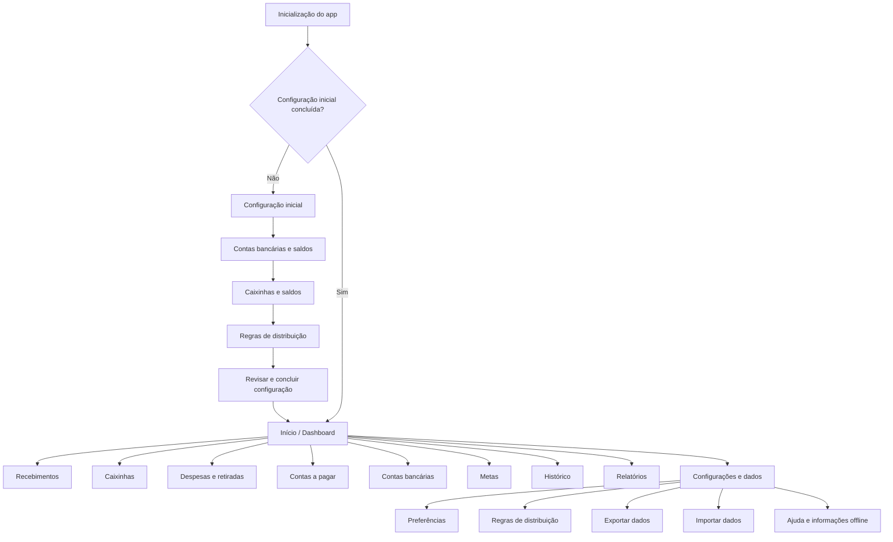
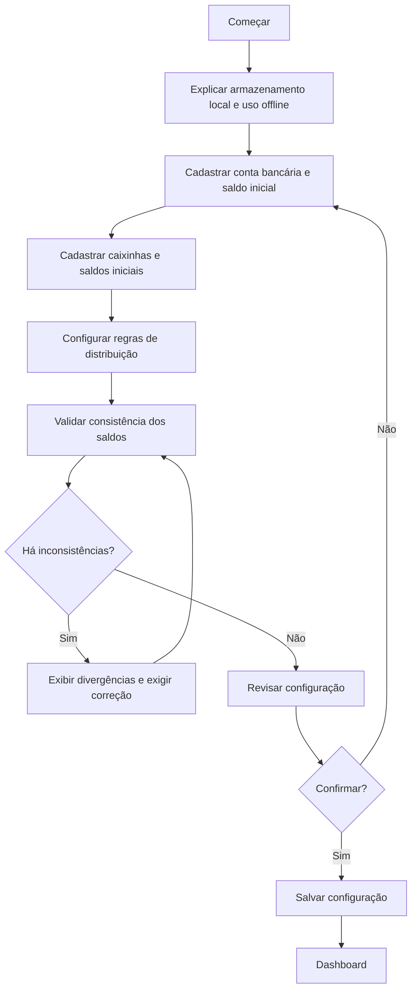
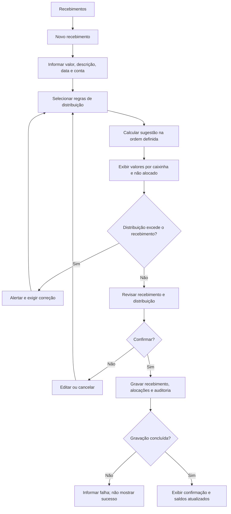
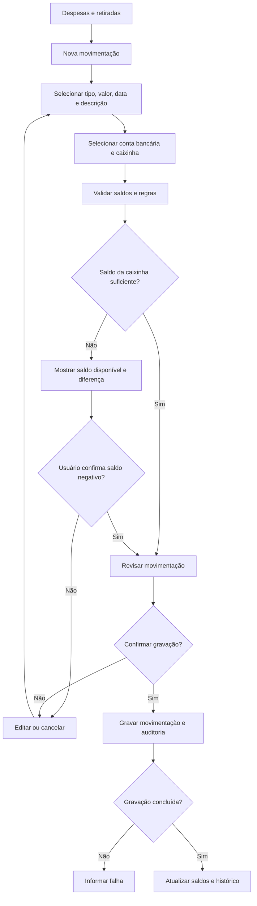
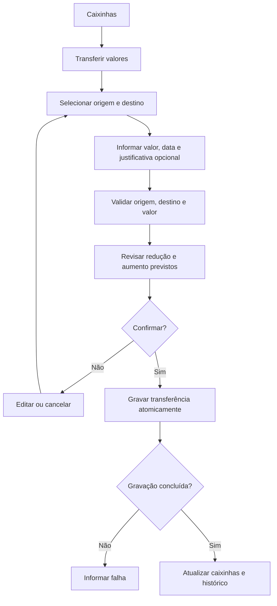
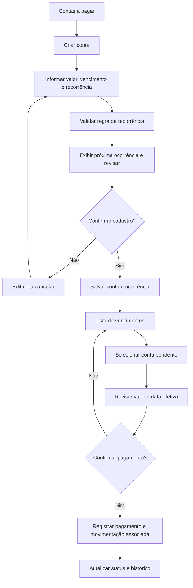
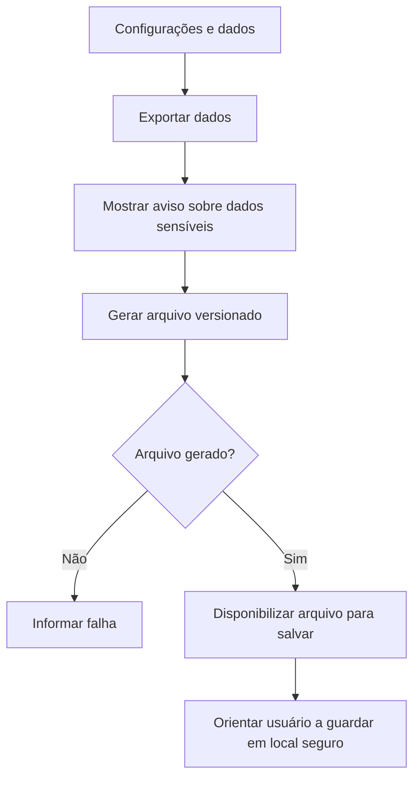
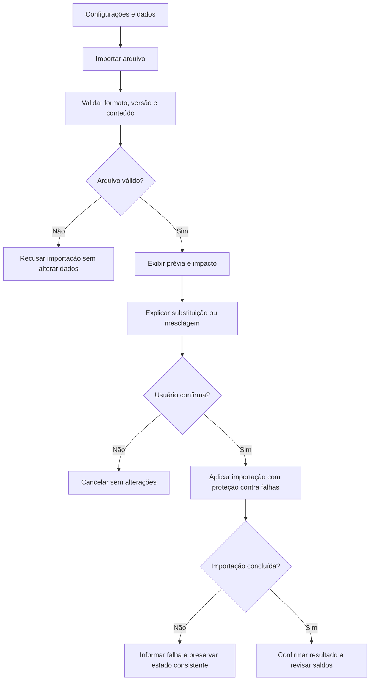

# T4 — Mapa de navegação e fluxos do Tangerina Financeiro

- **Projeto:** Tangerina Financeiro
- **Tarefa:** T4 — Desenhar mapa de navegação e fluxos
- **Área:** UX
- **Status:** Concluída — mapa documentado
- **Data:** 2026-10-27
- **Base:** Briefing do produto, decisões T1/T2/T3 e ADR-001
- **Escopo:** Navegação principal e fluxos centrais do MVP; não representa ainda wireframes finais.

## 1. Objetivo

Definir a estrutura de navegação e os principais percursos do usuário antes da implementação das telas. O mapa deve ajudar a manter a interface previsível, priorizar o uso em celular e evitar que uma operação financeira seja gravada sem revisão e confirmação.

## 2. Princípios de navegação

1. **Mobile-first:** no celular, usar navegação inferior para as áreas mais frequentes e acesso organizado às áreas secundárias.
2. **Ação principal evidente:** destacar ações como registrar recebimento, despesa e transferência.
3. **Confirmação explícita:** movimentações financeiras devem apresentar uma revisão antes de serem gravadas.
4. **Estado claro:** mostrar carregamento, sucesso, falha, ausência de dados e indisponibilidade de armazenamento.
5. **Saldos sem duplicidade:** distinguir saldo bancário, valores reservados nas caixinhas e valor não alocado.
6. **Offline-first:** indicar quando os dados estão sendo mantidos localmente e não depender de conexão para os fluxos financeiros essenciais.
7. **Acessibilidade:** não comunicar estados apenas por cor; manter rótulos, foco e mensagens compreensíveis.
8. **Sem login no MVP:** a configuração e os dados ficam no dispositivo, sem sincronização automática entre dispositivos.

## 3. Mapa geral de navegação

A navegação no celular deve priorizar **Início**, **Caixinhas**, **Movimentações** e **Contas a pagar**. As demais áreas devem estar acessíveis por um menu ou seção “Mais”, sem ficarem escondidas em uma sequência profunda de telas.

No computador, a mesma hierarquia pode ser apresentada em menu lateral.

## 4. Estrutura das áreas

| Área | Função principal | Ações prioritárias |
|---|---|---|
| Início | Visão geral financeira | Consultar saldo bancário, caixinhas, não alocado, próximos vencimentos e atalhos |
| Recebimentos | Registrar entradas e distribuir valores | Novo recebimento, simular distribuição, revisar e confirmar |
| Caixinhas | Organizar valores por finalidade | Consultar saldo, ver movimentações, ajustar regras e transferir entre caixinhas |
| Despesas e retiradas | Registrar saídas | Nova despesa, selecionar caixinha e conta, revisar saldo e confirmar |
| Contas a pagar | Controlar obrigações e vencimentos | Criar conta, configurar recorrência, consultar pendências e confirmar pagamento |
| Contas bancárias | Controlar contas reais | Consultar saldo, cadastrar conta, transferir entre contas e conciliar |
| Metas | Acompanhar objetivos financeiros | Criar meta, consultar progresso e registrar contribuições conforme o modelo escolhido |
| Histórico | Consultar operações registradas | Filtrar por período, tipo, conta, caixinha e categoria; consultar detalhes e alterações |
| Relatórios | Resumir movimentações | Consultar períodos, categorias e movimentações por caixinha |
| Configurações e dados | Gerenciar preferências e dados locais | Regras padrão, exportação, importação e informações sobre armazenamento local |

## 5. Fluxo de configuração inicial

**Regras do fluxo:**
- Não concluir a configuração enquanto houver inconsistências de saldo inicial que exijam correção.
- Apresentar valores e regras antes da confirmação.
- Se a gravação falhar, informar o problema e não apresentar a configuração como concluída.
- Não exigir login nem conexão com servidor para concluir a configuração local.

## 6. Fluxo de recebimento e distribuição

**Regras do fluxo:**
- A alteração pontual dos valores não modifica a regra padrão salva.
- O total distribuído e o valor não alocado devem ficar visíveis antes da confirmação.
- Uma distribuição excedente não pode ser corrigida silenciosamente.
- Recebimento e alocações relacionadas devem ser gravados como uma única operação lógica.
- A distribuição virtual entre caixinhas não deve ser contabilizada como saída bancária.

## 7. Fluxo de despesa ou retirada

**Regras do fluxo:**
- Se a caixinha ficar negativa, a aplicação exige confirmação explícita.
- A movimentação deve ser registrada uma única vez; uma diferença não pode gerar uma segunda despesa duplicada.
- A regra de bloqueio de retirada acima do saldo bancário deve ser respeitada.
- Retirada em dinheiro é uma transferência para a carteira física; despesas posteriores são registradas a partir dessa carteira, conforme a modelagem aprovada.
- A interface deve diferenciar despesa, retirada e transferência.

## 8. Fluxo de transferência entre caixinhas

**Regras do fluxo:**
- A origem e o destino devem ser diferentes.
- A operação reduz uma caixinha e aumenta outra.
- A transferência não altera o saldo bancário consolidado e não é nova receita ou despesa.
- A validação de saldo deve seguir as regras de negócio aprovadas para a operação.

## 9. Fluxo de transferência entre contas bancárias

1. Acessar **Contas bancárias** e escolher “Transferir”.
2. Selecionar conta de origem e conta de destino.
3. Informar valor e data.
4. Validar o saldo disponível na origem e as regras aplicáveis.
5. Revisar os efeitos nos dois saldos.
6. Confirmar ou cancelar.
7. Gravar os dois lados da transferência como uma única operação lógica.
8. Exibir o resultado e registrar no histórico.

A transferência não deve ser classificada como receita ou despesa consolidada. Por padrão, a retirada acima do saldo bancário é bloqueada.

## 10. Fluxo de contas a pagar e recorrência

**Regras do fluxo:**
- O vencimento não marca a conta como paga automaticamente.
- Contas vencidas permanecem pendentes até confirmação.
- Cada ocorrência recorrente paga permanece no histórico.
- Recorrências mensais no dia 29, 30 ou 31 precisam seguir a regra de calendário definida na T3 e nos critérios de aceitação.
- A criação de uma conta a pagar não deve criar uma despesa efetiva antes da confirmação de pagamento, conforme a regra de domínio a definir na implementação.

## 11. Fluxo de conciliação bancária

1. Acessar **Contas bancárias**.
2. Selecionar a conta e iniciar conciliação.
3. Informar o saldo real observado no banco e a data.
4. Comparar saldo real com saldo calculado.
5. Mostrar a diferença e solicitar justificativa.
6. Revisar o ajuste proposto.
7. Confirmar ou cancelar.
8. Gravar o ajuste e o registro de auditoria.
9. Exibir os saldos conciliados.

A conciliação não deve alterar movimentações antigas silenciosamente.

## 12. Fluxo de exportação e importação

### Exportação

### Importação

A política definitiva entre substituir e mesclar dados precisa ser definida antes da implementação da importação. A importação não deve começar a gravar dados antes da validação e da confirmação do usuário.

## 13. Estados transversais necessários

Todas as áreas devem prever os seguintes estados:

- **Carregando:** operação de leitura ou cálculo em andamento.
- **Vazio:** ainda não há registros; explicar como começar.
- **Validação:** campo ausente, formato inválido ou valor fora das regras.
- **Confirmação:** resumo dos efeitos financeiros antes de salvar.
- **Sucesso:** operação persistida e saldos atualizados.
- **Falha de gravação:** não apresentar a operação como concluída; orientar a tentar novamente.
- **Offline:** funções locais disponíveis; recursos que realmente exigem internet, se existirem, devem ser identificados.
- **Armazenamento indisponível:** impedir falsa confirmação e orientar sobre recuperação/backup.
- **Cancelado:** sair do fluxo sem persistir alterações não confirmadas.
- **Dados locais existentes:** não sobrescrever dados ao atualizar a aplicação.

## 14. Critérios de aceite da T4

- [x] O mapa inclui as áreas principais definidas no briefing.
- [x] A estrutura contempla navegação mobile-first e adaptação para desktop.
- [x] O fluxo de configuração inclui correção de saldos iniciais inconsistentes.
- [x] O fluxo de recebimento contempla prévia, valor não alocado e bloqueio de excedente.
- [x] O fluxo de despesa contempla confirmação de saldo negativo e prevenção de duplicidade.
- [x] Transferências entre caixinhas e entre contas estão separadas de receitas e despesas.
- [x] Contas a pagar distinguem vencimento de pagamento efetivo.
- [x] Conciliação exige justificativa e auditoria.
- [x] Exportação e importação contemplam validação, aviso e cancelamento.
- [x] Estados de erro, vazio, offline e falha de persistência foram identificados.

## 15. Pendências que não bloqueiam o mapa

Os seguintes pontos deverão ser resolvidos durante o detalhamento da arquitetura e dos componentes, sem serem tratados como decisões já aprovadas por este documento:

1. Escolha final entre importação por substituição ou mesclagem.
2. Detalhes de calendário para recorrências em dias inexistentes.
3. Regras completas para saldo negativo em cada tipo de movimentação.
4. Política visual definitiva para navegação inferior e menu secundário.
5. Necessidade futura de PIN/senha local e criptografia de exportação.

## 16. Resultado

O mapa de navegação e os fluxos principais estão documentados. A T4 pode ser marcada como concluída quanto à definição documental de UX. A implementação das telas, testes de usabilidade e validação dos fluxos permanecem tarefas futuras e não são declaradas concluídas por este documento.
